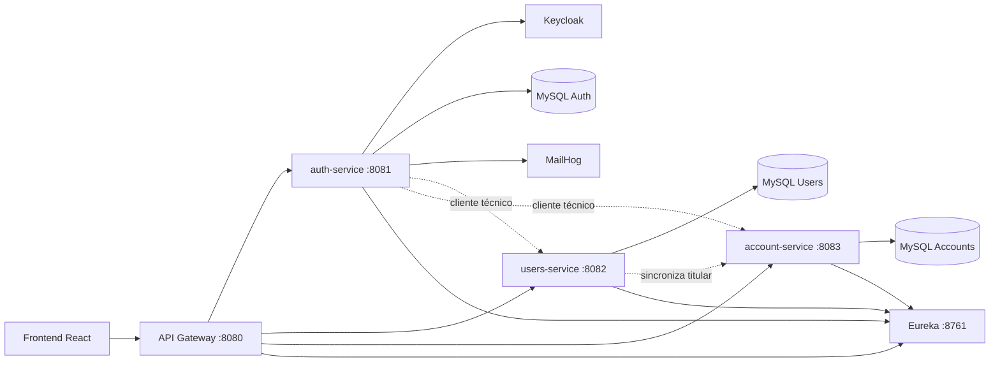

# Digital Money House

Digital Money House es una billetera digital desarrollada con arquitectura de microservicios. Permite registrar y autenticar usuarios, administrar perfiles, consultar cuentas con CVU y alias, asociar tarjetas, ingresar dinero, revisar movimientos y transferir saldo a otras cuentas. También genera comprobantes PDF de las operaciones.

## Tecnologías utilizadas

- Java 21, Spring Boot 3.3 y Spring Cloud 2023
- Spring Cloud Netflix Eureka, Gateway y OpenFeign
- MySQL 8.4, Spring Data JPA e Hibernate
- Keycloak 26, OAuth2/OpenID Connect y JWT
- React 18, TypeScript, Material UI y Tailwind CSS
- Docker y Docker Compose
- JUnit 5, Mockito, RestAssured y Postman
- Git, GitLab CI y GitHub

## Arquitectura

El sistema separa las responsabilidades de autenticación, usuarios y cuentas. El Gateway es el único punto de entrada de las APIs y los servicios se registran en Eureka.



El detalle de componentes, flujos y decisiones se encuentra en [la documentación de arquitectura](docs/infrastructure/architecture.md).

| Componente | Responsabilidad | Puerto local |
| --- | --- | --- |
| `discovery-server` | Registro y descubrimiento de servicios Eureka | 8761 |
| `api-gateway` | Entrada única, enrutamiento y validación JWT | 8080 |
| `auth-service` | Registro, acceso, recuperación de contraseña e integración Keycloak | 8081 |
| `users-service` | Perfil del usuario y sincronización del titular de la cuenta | 8082 |
| `account-service` | Cuentas, tarjetas, actividad, ingresos y transferencias | 8083 |
| `FrontEnd` | Interfaz web de la billetera | 3000 |

## Instalación y ejecución

### Requisitos

- JDK 21
- Maven 3.9 o superior
- Node.js 18 o superior y npm
- Docker Desktop con Docker Compose v2

### 1. Configurar variables locales

Desde la raíz del repositorio, creá el archivo local de variables:

```powershell
Copy-Item .env.example .env
```

Completá los valores de `.env`. Para generar el secreto técnico de Keycloak podés usar:

```powershell
[guid]::NewGuid().ToString('N') + [guid]::NewGuid().ToString('N')
```

Nunca publiques el archivo `.env` ni contraseñas reales.

### 2. Ejecutar la infraestructura local

```powershell
docker compose up -d
docker compose ps
docker compose logs keycloak-bootstrap --tail 30
```

El bootstrap debe informar `Cliente técnico de Keycloak configurado.`. Servicios auxiliares disponibles:

| Servicio | URL |
| --- | --- |
| Keycloak | http://localhost:8180 |
| MailHog | http://localhost:8025 |
| Eureka | http://localhost:8761 |

### 3. Ejecutar los microservicios manualmente

Primero verificá la compilación:

```powershell
mvn clean test
```

Luego iniciá cada módulo en terminales separadas, en este orden:

```powershell
mvn spring-boot:run -pl discovery-server
mvn spring-boot:run -pl users-service
mvn spring-boot:run -pl account-service
mvn spring-boot:run -pl auth-service
mvn spring-boot:run -pl api-gateway
```

### 4. Ejecutar el frontend

```powershell
Set-Location FrontEnd
npm install
npm start
```

Abrí http://localhost:3000. La API se consume mediante el Gateway en http://localhost:8080.

### Ejecución integral con contenedores

El archivo `docker-compose.cloud.yml` construye las imágenes de los microservicios y del frontend, preparado para una instancia cloud:

```powershell
docker compose -f docker-compose.cloud.yml --env-file .env up --build -d
docker compose -f docker-compose.cloud.yml ps
```

En una PC local usá `FRONTEND_PORT=8088` en `.env` si el puerto 80 está ocupado. Para desplegar en AWS, seguí [la guía de infraestructura](docs/infrastructure/aws-deployment.md).

## Endpoints principales

Todas las rutas se exponen a través de `http://localhost:8080/api`. Las rutas protegidas requieren el encabezado `Authorization: Bearer <accessToken>`.

### Autenticación y usuario

| Operación | Ruta | Respuestas relevantes |
| --- | --- | --- |
| Registro | `POST /auth/register` | `201`, `400`, `409` |
| Inicio de sesión | `POST /auth/login` | `200`, `400`, `401` |
| Cierre de sesión | `POST /auth/logout` | `200`, `401` |
| Consultar perfil | `GET /users/{userId}` | `200`, `401`, `403`, `404` |
| Actualizar perfil parcial | `PATCH /users/{userId}` | `200`, `400`, `401`, `403`, `404` |

Ejemplo de actualización parcial:

```json
{
  "firstName": "Valentina",
  "phone": "1122334455"
}
```

Al modificar nombre o apellido, se sincroniza el `holderName` de la cuenta.

### Cuenta, tarjetas e ingresos

| Operación | Ruta | Respuestas relevantes |
| --- | --- | --- |
| Consultar cuenta propia | `GET /accounts/me/{userId}` | `200`, `401`, `404` |
| Actualizar alias | `PATCH /accounts/{accountId}` | `200`, `400`, `403`, `404`, `409` |
| Asociar tarjeta | `POST /accounts/{accountId}/cards` | `201`, `400`, `403`, `404`, `409` |
| Listar tarjetas | `GET /accounts/{accountId}/cards` | `200`, `403`, `404` |
| Ingresar dinero | `POST /accounts/{accountId}/transferences` | `201`, `400`, `403`, `404` |
| Consultar actividad | `GET /accounts/{accountId}/activity` | `200`, `400`, `403`, `404` |

Ejemplo de ingreso usando una tarjeta vigente:

```json
{
  "cardId": "uuid-de-la-tarjeta",
  "amount": 1500.00
}
```

La fecha de vencimiento de las tarjetas usa el formato `MMYY`; debe representar el mes actual o uno futuro.

Para filtrar actividad, `range` acepta: `ZERO_TO_1000`, `FROM_1000_TO_5000`, `FROM_5000_TO_20000`, `FROM_20000_TO_100000` y `OVER_100000`.

### Transferencias y comprobantes

| Operación | Ruta | Respuestas relevantes |
| --- | --- | --- |
| Transferir a CVU, CBU o alias | `POST /accounts/{accountId}/transferences` | `200`, `400`, `403`, `404`, `410` |
| Últimos destinatarios | `GET /accounts/{accountId}/transferences` | `200`, `403`, `404` |
| Detalle de actividad | `GET /accounts/{accountId}/activity/{transactionId}` | `200`, `403`, `404` |

Ejemplo de transferencia:

```json
{
  "destination": "rio.rio.mar",
  "amount": 400.00
}
```

`410 Gone` indica fondos insuficientes. El frontend permite descargar desde el detalle de actividad un comprobante PDF con la información visible de la operación.

## Testing

### Colección Postman

La colección se encuentra en [docs/postman/Digital-Money-House.postman_collection.json](docs/postman/Digital-Money-House.postman_collection.json). Importala en Postman y configurá sus variables de entorno. Incluye scripts para guardar tokens e identificadores generados durante el flujo.

### Tests automatizados

```powershell
mvn clean test
```

Para los smoke tests HTTP se requiere la infraestructura levantada:

```powershell
$env:RUN_API_SMOKE_TESTS = "true"
mvn test -pl account-service
```

La cobertura incluye autenticación, actualización de perfil, cuentas, tarjetas, actividad, ingresos, transferencias exitosas y fallidas, permisos sobre cuentas ajenas y recursos inexistentes.

### Prueba manual sugerida

1. Registrá dos usuarios y verificá ambos correos en MailHog.
2. Iniciá sesión con el primer usuario y asociá una tarjeta vigente.
3. Ingresá dinero y comprobá el saldo y la actividad.
4. Transferí dinero al alias, CVU o CBU del segundo usuario.
5. Revisá el saldo de ambas cuentas, los últimos destinatarios y el comprobante PDF.

La planificación, casos, ejecución exploratoria y cierre de calidad están versionados en [docs/testing](docs/testing/). La suite clasificatoria está disponible en [Digital-Money-House-Test-Suites.xlsx](docs/testing/Digital-Money-House-Test-Suites.xlsx).

## Decisiones de diseño y buenas prácticas

- **Keycloak y JWT:** la identidad, contraseñas y tokens se delegan a Keycloak; los servicios validan los JWT en el Gateway y en sus propias fronteras.
- **Datos por dominio:** cada microservicio mantiene su propia base MySQL para reducir acoplamiento.
- **Gateway y Eureka:** el Gateway centraliza el acceso externo; Eureka permite descubrir los servicios sin direcciones codificadas.
- **Cliente técnico:** Auth Service usa un cliente de servicio para coordinar altas y actualizaciones necesarias sin exponer credenciales de administración al frontend.
- **Transferencias atómicas:** la operación valida destinatario y fondos antes de actualizar ambos saldos y registrar los movimientos relacionados.
- **Secretos fuera del repositorio:** `.env` está ignorado; `.env.example` funciona como contrato de configuración reproducible.

## Problemas comunes

| Situación | Solución |
| --- | --- |
| Los servicios no arrancan en Docker | Revisá `docker compose ps`, esperá los healthchecks y consultá los logs del servicio afectado. |
| Error de credenciales o cliente técnico | Comprobá `.env` y ejecutá `docker compose logs keycloak-bootstrap --tail 30`. |
| CORS o respuesta 403 desde el frontend | Usá siempre el Gateway y verificá que el token Bearer no haya expirado. |
| El puerto 80 muestra otra aplicación | Definí `FRONTEND_PORT=8088` y abrí http://localhost:8088. |
| Una tarjeta no puede asociarse o cargar dinero | Revisá número, vencimiento `MMYY` vigente y que no esté duplicada. |

## Documentación adicional

- [Arquitectura](docs/infrastructure/architecture.md)
- [Despliegue cloud/AWS](docs/infrastructure/aws-deployment.md)
- [Colección de Postman](docs/postman/Digital-Money-House.postman_collection.json)
- [Plan de pruebas Sprint 4](docs/testing/sprint-4-test-plan.md)
- [Pruebas exploratorias Sprint 4](docs/testing/sprint-4-exploratory-testing.md)
- [QA Sign Off Sprint 4](docs/testing/sprint-4-qa-sign-off.md)

## Checklist de entrega

- [x] README con instalación, ejecución, arquitectura, API y testing.
- [x] Diagrama de arquitectura versionado.
- [x] Colección Postman incluida.
- [x] Casos de prueba, evidencia exploratoria y QA Sign Off versionados.
- [x] Docker Compose local y de despliegue cloud documentados.
