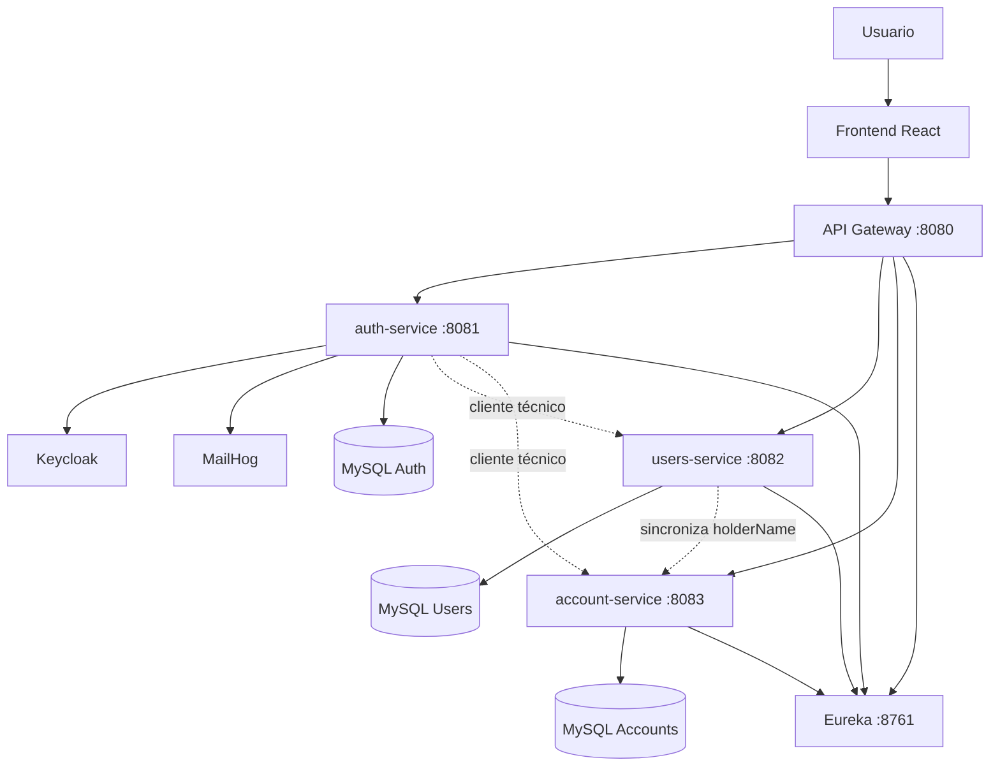

# Arquitectura de Digital Money House

## Objetivo

Digital Money House implementa una billetera digital mediante microservicios independientes. Cada servicio es responsable de un dominio funcional y de su propia persistencia; la comunicación externa entra por el API Gateway.

## Componentes

| Componente | Rol |
| --- | --- |
| Frontend React | Interfaz de usuario para registro, perfil, tarjetas, actividad, ingresos y transferencias. |
| API Gateway | Punto de entrada único, enrutamiento de rutas `/api/**` y validación de acceso JWT. |
| Discovery Server | Registro y descubrimiento de instancias mediante Eureka. |
| Auth Service | Registro, login, logout, recuperación de contraseña, envío de correo y coordinación con Keycloak. |
| Users Service | Consulta y actualización parcial del perfil del usuario. |
| Account Service | Cuenta, CVU, alias, tarjetas, movimientos, actividad, ingresos y transferencias. |
| Keycloak | Proveedor de identidad OAuth2/OIDC, usuarios y tokens JWT. |
| MailHog | Buzón local para inspeccionar emails de verificación y recuperación. |
| MySQL | Una base independiente para Auth, Users y Accounts. |

## Flujos principales

### Registro e inicio de sesión

1. El frontend invoca al Gateway.
2. Auth Service valida la información, crea la identidad en Keycloak y coordina la creación de los datos de usuario y cuenta.
3. La cuenta obtiene un CVU y alias iniciales.
4. Keycloak autentica al usuario y Auth Service retorna los tokens de acceso.

### Actualización de perfil

1. El usuario envía solo los campos que desea modificar a Users Service.
2. Users Service verifica propiedad y actualiza su base de datos.
3. Si cambian nombre o apellido, sincroniza el titular (`holderName`) con Account Service.
4. Si se modifica email o contraseña, Users Service solicita a Auth Service la actualización de la identidad en Keycloak.

### Ingreso de dinero y transferencia

1. Account Service valida que la cuenta corresponda al usuario autenticado.
2. Para un ingreso, valida que la tarjeta exista, pertenezca a la cuenta y no esté vencida.
3. Para una transferencia, localiza el destino por alias, CVU o CBU y verifica saldo suficiente.
4. La operación persiste los saldos y movimientos relacionados de forma transaccional.
5. El frontend muestra el detalle de actividad y puede generar un comprobante PDF.

## Seguridad y persistencia

- Las rutas públicas se limitan a registro, login, recuperación de contraseña y recursos necesarios para el flujo de identidad.
- El resto de las rutas requiere un JWT válido y controles de propiedad sobre el recurso solicitado.
- Las credenciales y secretos se configuran por variables de entorno; `.env` no se versiona y `.env.example` documenta las requeridas.
- Docker Compose usa healthchecks y dependencias condicionadas para iniciar los servicios cuando sus dependencias están listas.
